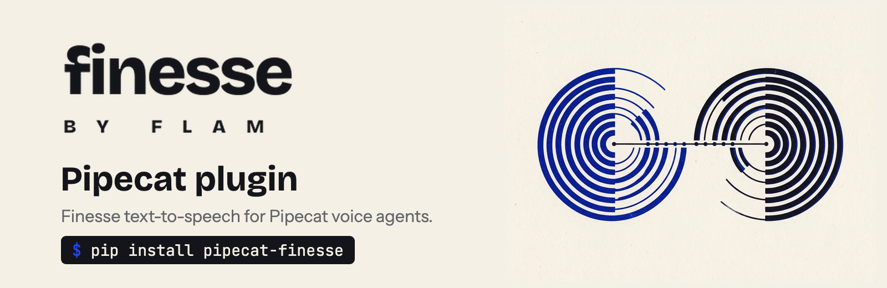

<picture>
  <source media="(prefers-color-scheme: dark)" srcset="https://raw.githubusercontent.com/homingos/pipecat-finesse/main/.github/assets/banner-pipecat-dark.png">
  <source media="(prefers-color-scheme: light)" srcset="https://raw.githubusercontent.com/homingos/pipecat-finesse/main/.github/assets/banner-pipecat-light.png">
  
</picture>

<p>
  <a href="https://pypi.org/project/pipecat-finesse/"></a>
  
  
  
  <a href="https://github.com/homingos/pipecat-finesse/blob/main/LICENSE"></a>
</p>

# pipecat-finesse

[Finesse](https://finesse.flamapp.ai) text-to-speech for [Pipecat](https://github.com/pipecat-ai/pipecat).

Finesse streams speech in 60 languages, 22 of them Indian, from your own cloned voices or the
Finesse catalog. This package adds `FinesseTTSService`, which speaks over the Finesse realtime
WebSocket:

- **Streams as the LLM writes.** Text goes to Finesse as it arrives, so speech starts before the
  reply is finished.
- **One context per turn.** All sentences of an LLM turn share one Finesse context, so prosody
  carries across them.
- **Interruptions.** When the user talks over the bot, the turn is cancelled on the server and its
  remaining audio is dropped; the connection stays open for the next turn.
- **Any pipeline rate.** 8 kHz telephony pipelines get 8 kHz audio straight from Finesse, with no
  resampling; other rates below its native 24 kHz, such as 16 kHz, are resampled for you.

Maintained by [Flam](https://finesse.flamapp.ai), the company that builds Finesse.

## Compatibility

Tested with Pipecat v1.12.0 and v1.16.0 (`pipecat-ai>=1.12,<2`). See the [changelog](CHANGELOG.md) for updates.

## Install

```bash
pip install pipecat-finesse
```

## Use

```python
from pipecat.transcriptions.language import Language
from pipecat_finesse import FinesseTTSService

tts = FinesseTTSService(  # reads FINESSE_API_KEY
    settings=FinesseTTSService.Settings(
        voice="<your voice id>",
        language=Language.HI,
    ),
)
```

Put it in a pipeline where any other TTS service goes. `examples/voice_agent.py` is a complete
voice agent (Deepgram, OpenAI, Finesse) that runs in your browser:

```bash
cp .env.example .env   # fill in the keys
uv run --with "pipecat-ai[deepgram,openai,runner,silero,webrtc]" examples/voice_agent.py
```

### Getting a key and a voice

Create an API key in the [Finesse dashboard](https://finesse.flamapp.ai/dashboard) under
**Settings → API keys**. Pick a voice from the dashboard's voice library, one of your cloned voices,
or list them with the [List voices API](https://docs.finesse.flamapp.ai/voice-api/list-voices); use
the voice's `id`.

### Settings

| Setting | Default | Notes |
|---|---|---|
| `voice` | required | Flam voice id |
| `language` | `Language.EN` | Pipecat `Language` or a Finesse code; mapped to Finesse codes (Odia `ory`, Nepali `npi`, Egyptian Arabic `ar-EG` → `arz`, Gulf Arabic `ar-AE` → `afb`, ...) |
| `num_step` | server default (32) | 1-32, quality vs latency |
| `guidance_scale` | server default (2.0) | 0-10 |
| `length_scale` | server default (1.0) | speaking rate, higher is slower |

Constructor options: `api_key`, `sample_rate`, `idle_flush_ms`
(how long the server waits before speaking a partial sentence, 200-5000 ms) and `client_name`
(added to the `X-Finesse-Client` header so you can tell your apps apart in Finesse analytics).

Voice and language apply per turn: a change takes effect from the next turn.

## Errors and limits

- A refused connection reports the HTTP status and Finesse error code, e.g.
  `HTTP 429 (concurrency_limited, retry after 1s)` when you are at your plan's concurrent-stream
  limit, or `HTTP 503 (upstream_busy, ...)` when the service is at capacity. The service retries
  with backoff.
- Each open connection holds one of your plan's concurrent streams until it closes.
- Errors for one turn (for example `voice_not_found`) end that turn and leave the connection open.
- If the connection drops mid-turn, or the server cancels a turn, the turn ends with an error
  instead of going silent, and the next turn reconnects.
- A slow first audio (a long first sentence, a busy engine) is still played: the service waits up
  to 10 s (`stop_frame_timeout_s`) before giving up on a turn's audio.

API reference: [Realtime WebSocket](https://docs.finesse.flamapp.ai/voice-api/realtime-websocket).

## Development

```bash
uv sync
uv run pytest                    # unit tests against a fake server
FINESSE_LIVE=1 FINESSE_API_KEY=... FINESSE_VOICE_ID=... \
  FINESSE_URL=<non-production realtime URL> \
  uv run pytest tests/test_live.py
```

## License

BSD 2-Clause, the same as Pipecat.
